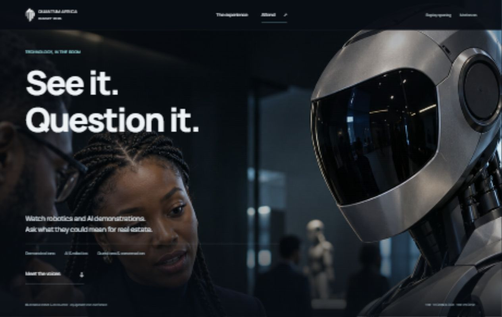
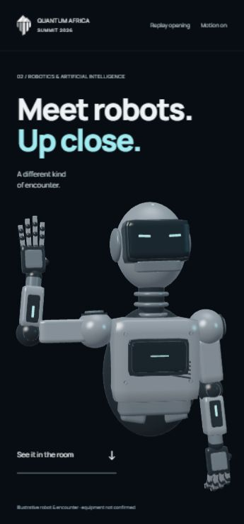
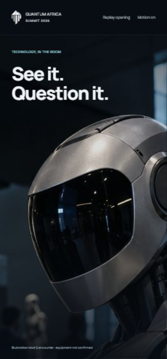

# Robotics correction — 25 October 2026

The user rejected using the photographic pullback as the “Meet robots. Up close.” encounter. This correction adds a real, articulated, locally authored WebGL robot. The liked photographic head-to-human-context pullback belongs entirely to “See it. Question it.” Speaker cutouts, clearer speaker copy, removal of the duplicate list and workshop/networking direction are recorded next; they are not changed in this slice.

Objective: a recognisable 3D robot enters, turns toward the visitor and opens its hand with scroll, then leaves into the photographic encounter. No required viewing time, video masquerading as geometry, external model download, installation, live Blender control or new service account.

Implementation boundary: one alpha canvas alongside semantic HTML in the existing robotics chapter. Native WebGL geometry, lighting and authored articulation; no new library or external code import. The robot is an original illustrative design, not confirmed event equipment. This is R2 local prototype work; rollback is the chapter/module files, not external state.

Highest risks: a toy-like robot, a hand that reads poorly on a phone, text collisions, a seam between canvas/photo, rendering continuing offscreen, context failure leaving an empty pinned stage. Evidence: actual IAB phone and desktop screenshots, forward/reverse scroll, reduced-motion/static route, GL error checks and resource/lifecycle inspection. Physical-device GPU/battery measurements remain outside current evidence.

| Beat | Chapter progress | Visual job | What the visitor sees | Transition |
| --- | --- | --- | --- | --- |
| Arrive | 0–.13 | Recognise the machine | Silver articulated robot moves into the open ink scene beneath/beside “Meet robots. Up close.” | The robot turns toward the visitor |
| Encounter | .13–.36 | Feel physical articulation | Forearm rises, palm opens, fingers uncurl, wrist gives a small greeting | Pose has a readable hold |
| Handoff | .36–.54 | Connect demonstration to people | Robot withdraws as the existing photograph becomes visible across the full scene | No framed card or page-wide divider |
| Observe | .54–.66 | Introduce a real encounter | The photograph's close visor view with “See it. Question it.” | Pull back within the same photograph |
| Question | .66–1 | Reveal human context | Practitioner, visitor and robot hand become visible; invitation to continue | Ordinary scrolling exits |

Mobile uses a capped pixel ratio and collision-safe model placement. Reduced motion renders one settled 3D pose and ordinary photo/copy flow; no compulsory scrolling animation. Context failure keeps a clear message and the photograph/content. Render only on changed pose/size, pause offscreen/hidden, and dispose resources on terminal page exit.

## Evidence and review limits

### Desktop photo correction after the user's review

The user accepted the 3D pass as workable and specifically praised mobile. Desktop must use the same immersive photograph behind the type rather than the previous right-hand portrait/text-column composition. The photo now covers the entire stage at desktop width, moving from the head close-up into a wider crop around the people. The mobile camera equations, 3D geometry and gesture are preserved. A lighter desktop shade maintains visible image detail behind the overlay.

Checked at 1280×800: close-up and wider hold both fill the stage, with the wider photo at left 0 and width approximately 1265 CSS pixels (the remaining viewport width includes the scrollbar). No horizontal overflow. Checked at 390×844: the liked phone close-up is intact, stage internal scroll remains zero, WebGL reports error 0. JavaScript syntax check passed. The original source remains a portrait photograph, so the wide layout uses an authored crop rather than stretching it.

- Actual Codex in-app browser inspected at 390×844, 360×740 and 1280×800. Scroll controls visible head/body orientation and the forearm, wrist and individual fingers. The canvas reports `native-webgl`, approximately 95,520 submitted triangles and GL error 0 in checked poses. This is real geometry, not a generated video or flat render.
- At 360×740 the settled gesture was checked around progress .2882. Render count held at 52 across separate idle observations, demonstrating that this scene does not continually redraw an unchanged pose. Pixel ratio is capped at 1.35 on phones and 1.5 on desktop. No measured physical-device FPS/battery claim is made.
- At progress .57 the model opacity is zero, the photograph clip is `none`, and “See it. Question it.” is visible. Scrolling farther reveals the practitioner, visitor and articulated hand within the same photograph. Reverse movement was inspected through the previous transition; final refinement remains reviewable.
- Keyboard Enter on “See it in the room” exposed an internal scroll issue in the pinned stage. `overflow: clip` prevents that scroll. Retest showed internal scroll 0 and the context heading at approximately 101px on the small phone, with no split-looking photo.
- Static route renders one settled pose (render count 1, pose .2600, GL error 0) and ordinary heading → 3D object → photo → context flow. There is no scroll animation in this route.
- Syntax checks passed for both robotics modules. Source-error fallback and context restoration are implemented but have not been fault-injected in the browser. Final visual acceptance, physical mobile GPU behavior and the subsequent speaker correction remain open.

