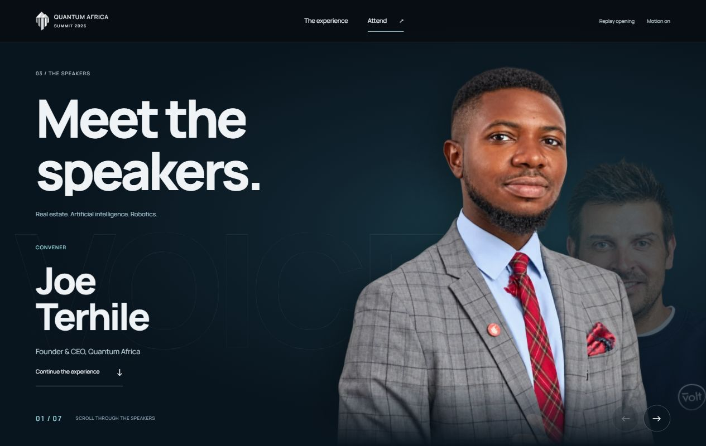
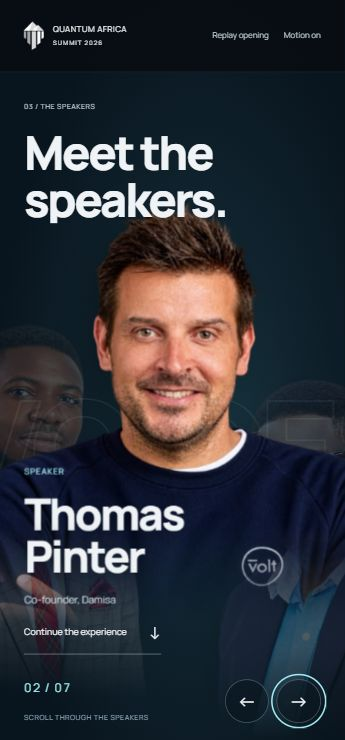

# Speaker cutout review — 25 October 2026

The user explicitly praised and accepted the new visual direction after seeing the speaker scene: it matched what they had been imagining. This acceptance applies to the cutout speaker treatment, not the unfinished workshops/networking/partnerships or commercial sections. Faith Odiase's labelled flyer portrait has now been supplied and selected by the user, extracted and integrated. All seven speakers now have portraits.

## What changed

The framed portrait slides became transparent photographic cutouts in a single full-scene composition. Scroll controls translation, scale, depth, overlap and caption entrance. The heading explicitly says “Meet the speakers.” The duplicate “Many perspectives. One room.” list is removed. Seven figures preserve all seven names/roles once. The old list anchor remains only as a one-pixel bookmark alias.

The technique is a scroll-driven layered cutout reveal, or 2.5D parallax: flat photographs are arranged and animated to suggest depth. It is distinct from the genuinely modelled WebGL robot in the previous chapter.

Six source portraits were edited through the built-in image tool. Original JPGs and generated PNGs are preserved; the delivered alpha WebPs total 570,610 bytes. [Asset provenance and prompts](assets/speakers/CUTOUT-PROVENANCE.md) record sources and generation outputs. The new Dr Kunle Adeyemi image is explicitly labelled by Sterling Homes and cross-checked against the REDAN role. Faith's inaccessible public profile was not bypassed, and no face was invented for her.

## Evidence actually checked

- Actual Codex in-app browser at 390×844, 360×740 and 1280×800. Desktop composition and the small-phone Thomas name/face spacing were visually inspected and captured.
- Keyboard Enter on Next reached Thomas, Nofa, Faith, Olubori, Dr Kunle and Ajulo. Final count 07/07, Next disabled, and all six image files loaded. A polite status announces deliberate button-driven changes, not every scroll update.
- Previous returned to Joe with count 01/07 and Previous disabled. Internal stage scroll remained zero; no horizontal overflow in checked views.
- Continue reached the following experience section without requiring the whole sequence.
- Static route exposed all seven figures and headings once; the scene is position:relative in ordinary page flow. No pinned reveal is required.
- Source checks: seven figures, seven name headings, no duplicate list, valid local references and unique IDs. Six delivered WebPs have alpha range 0–255; original PNG transparency was checked before preparation. JavaScript syntax passed. Final browser error/warning query was empty.
- Missing portraits use a name-only presentation. Neighbouring photographs clear while that name is readable so no other person's face is associated with it. An image-load error switches to the same treatment; browser fault injection was not performed.

## Remaining work

Faith's user-selected glasses-free portrait is now integrated; see [source and prompt](assets/speakers/FAITH-CUTOUT.md). Generated cutouts are reference-based edits, not pixel-identical segmentations; final media selection remains with the user. Physical-device FPS/memory/battery and broader browser coverage have not been measured. The accepted robotics implementation and mobile photo camera equations were not changed by this slice.

Workshops, networking/panels, strategic partnerships, remaining event experiences and the commercial/partner/footer sections remain on the correction queue.

## Faith portrait follow-up

User-selected glasses-free portrait extracted from the supplied, labelled TAFTA flyer using the built-in image tool. Seven portraits now present. Faith delivery WebP 800×998, 120,538 bytes, alpha 0–255. Actual IAB phone 390×844 and desktop 1280×800 visually checked; keyboard navigation reached Faith at 04/07 and her image loaded at natural size 800×998. No phone horizontal overflow; browser warning/error query empty. Mobile lower-caption shading keeps role legible over the pale blazer. Saved proof: evidence/speaker-cutouts/phone-faith.png and desktop-faith.png. No robotics, hero or speaker controller changes.
