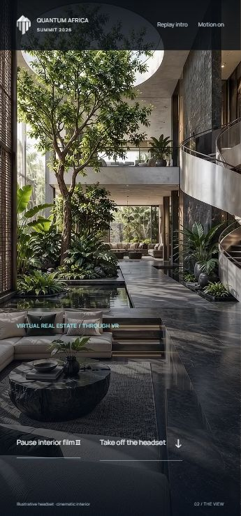

# VR courtyard film integration — 25 October 2026

## Change brief

Objective: replace the provisional room still with the user's supplied courtyard film inside the accepted physical-headset transition. Local prototype implementation only, risk R2. No new hero direction, headset geometry, provider generation, installation or live-site change.

Changed boundary: the native video clock now owns film playback and two typography beats. Native scroll still owns putting on/taking off the headset. The source file remains untouched in Downloads. Recovery is reverting the new player module and room markup; no external state is affected.

Highest-risk assumptions: automatic playback must not continue after exit, copy must pause with the film, and the portrait scene must remain useful in the wider desktop crop. Tested against the served local page rather than inferred from syntax checks.

## Asset and treatment

User-supplied source: `C:\Users\Oviks\Downloads\VR_headset_navigating_architectu…_1080p_20261025080300.mp4`.

FFprobe: 10.000 seconds, 1080×1920, H.264, 24fps, 23,049,339 bytes, with an AAC audio stream. Source audio was not critically auditioned. The web treatment is intentionally silent.

`assets/vr-courtyard-web.mp4`: 720×1280, 10 seconds, H.264, no audio, fast-start MP4, 4,418,873 bytes (about 81% smaller than the supplied file). `assets/vr-courtyard-film.mp4` is the retained 1080×1920 silent intermediate. `assets/vr-courtyard-poster.jpg` is the source's actual first frame, not a similar independently generated room.

Contact samples at two-second intervals show the camera progressing through the courtyard, beside the reflecting pool/tree and toward the lounge. These samples and browser playback are bounded visual evidence, not a claim of frame-by-frame continuity perfection or actual venue coverage.

## Playback contract

- Starts naturally once the headset reaches the inside-view interval. No scroll scrubbing, required watch duration or endless loop.
- Clear opening until 1.8 seconds; first message enters 1.8–2.2, holds, and clears 4.4–4.8. Second enters 5.5–5.9 and clears 8.2–8.6. The ending is free of large type.
- Pause/resume, replay after ending and immediate Take off remain available. The end frame rests.
- Exit and hidden-tab events pause the film. Manual pause is retained during ordinary scrolling. A pending play request checks the current mode before continuing.
- Static/reduced-motion route does not autoplay; native controls and an explicit play button remain available. Still imagery survives media failure. Source/video errors show a short message.
- No continuation was fabricated, no clip was duplicated to reach twenty seconds, and no provider upload/spend occurred.

## Evidence actually checked

- FFprobe confirmed source/output dimensions, duration and stream types. JavaScript syntax checks passed.
- Codex in-app browser: 390×844, 360×740 and 1280×800. Film decoded with readyState 4; no horizontal overflow at the checked sizes.
- Entry produced real advancing currentTime. Pause held at 5.0753 seconds across subsequent checks; replay returned to the beginning. At the ending, currentTime was 10, ended and paused were true, and both large phrases were hidden.
- Scrolling out while playing stopped the film at 0.5384 seconds and cleared the active-film state. Take off returned to the Summit invitation and Robotics & AI link.
- Static route began paused at time zero with native controls; explicit playback worked. Return key on the play/pause control paused the film.
- Phone and desktop screenshots were inspected. The active-film header now has sufficient dark backing against the bright courtyard image.

Browser fault injection for missing video and a real hidden-tab transition were not run. Physical-device network performance and creative acceptance remain unverified. The countdown/remaining tickets are not completed by this change.

## Review

Preview: http://127.0.0.1:4360/#top . Choose Put on the headset.

